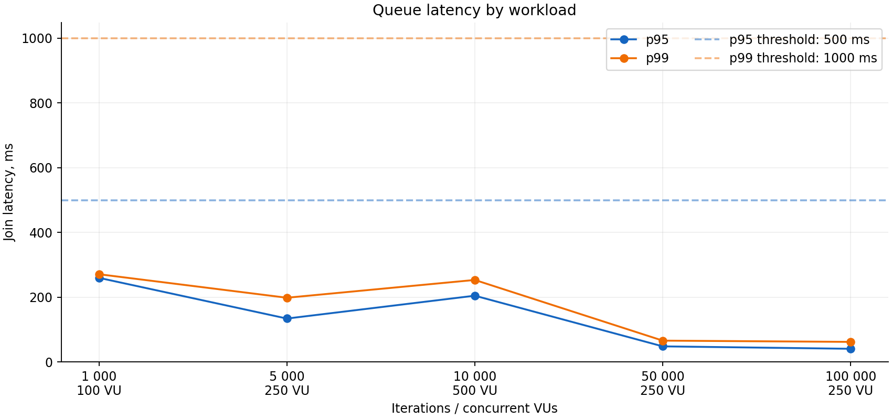
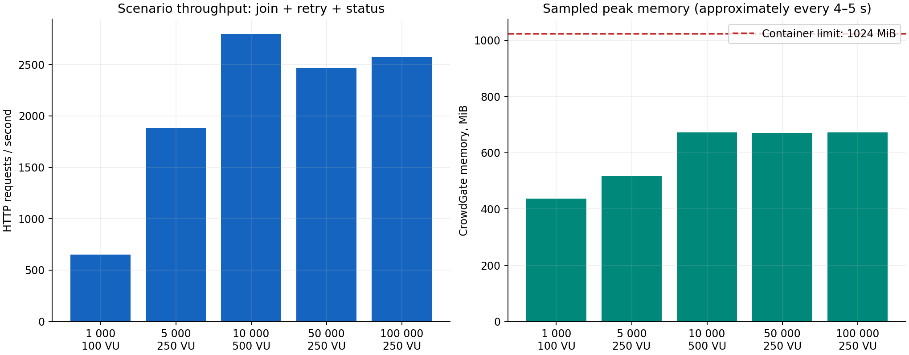
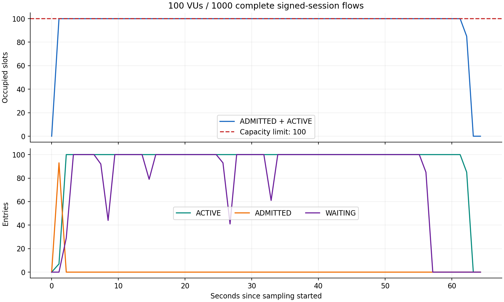
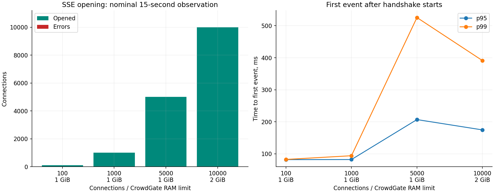
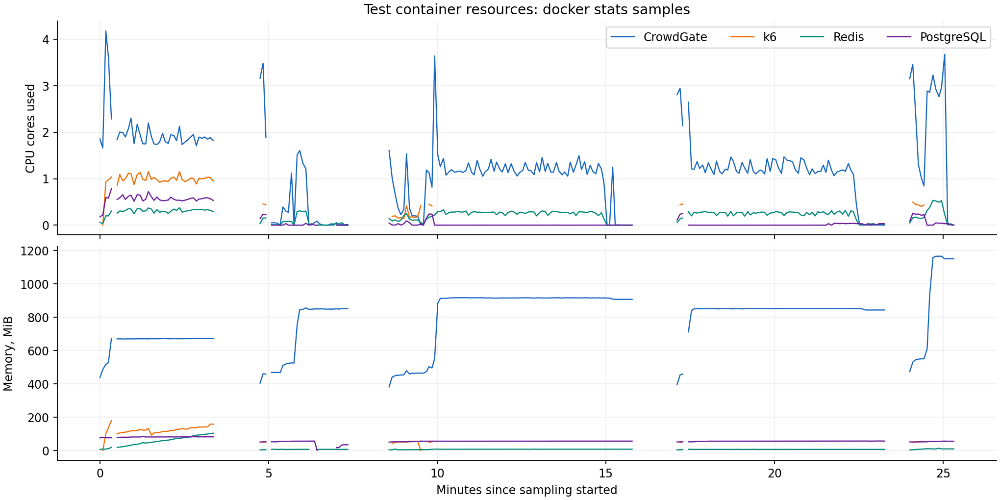

# CrowdGate

This README has two parts:

1. [Project overview](#1-project-overview): purpose, technologies, integration and setup.
2. [Testing](#2-testing): measured results, charts and limitations.

## 1. Project overview

CrowdGate is a self-hosted virtual waiting room that protects web applications from traffic spikes. Instead of allowing every visitor to reach a limited-capacity service at once, it places visitors in a FIFO queue and grants access at a controlled rate.

It can be integrated into ticket sales, product launches, registration systems and other applications where demand may exceed available capacity. Each gate defines an admission rate, a maximum number of active sessions and access time limits.

Visitors receive live queue updates and a signed admission token when their turn arrives. The protected application verifies the token and activates access through CrowdGate once. Subsequent requests are checked locally, so CrowdGate does not sit in the path of every application request.

### Features and stack

- FIFO queues, admission rate and capacity limits; gate opening, pausing, closing and scheduling.
- HMAC-SHA256 admission tokens, session TTLs and heartbeats.
- Owner-scoped queue updates through Server-Sent Events (SSE).
- Redis-backed request throttling, protected administration and Prometheus metrics.
- A separate demo backend demonstrating one-time activation and subsequent local token checks.

| Component | Technology |
|---|---|
| Service | Java 21, Spring Boot 3.5.16, Spring WebFlux |
| Gate configuration | PostgreSQL 17, Spring Data JPA / Hibernate, Flyway |
| Queue and session state | Redis 7.4, Lettuce, atomic Lua scripts, sorted sets |
| Monitoring | Micrometer, Spring Boot Actuator, Prometheus, Grafana |
| Verification | JUnit 5, Testcontainers, Reactor Test, k6 |
| Build, packaging and CI | Maven, Docker, Docker Compose, GitHub Actions |

PostgreSQL stores gate configuration; Redis handles queue order, reservations, sessions and atomic state transitions. Visitor cookies identify queue ownership; they are not a replacement for application authentication.

### Integrating an application

1. Create and open a gate through `/api/v1/admin/gates`, using `X-Admin-Key`.
2. Send visitors to `POST /api/v1/gates/{gateId}/join`. Preserve the visitor identity cookie.
3. Read queue status or subscribe to `GET /api/v1/queue/{queueToken}/events`.
4. Once ADMITTED, obtain a signed token through `POST /api/v1/queue/{queueToken}/admission-token`; SSE admission events also include it.
5. The protected backend verifies the HMAC, expiry and expected gate locally, then performs the initial activation through `POST /api/v1/tokens/redeem` with the visitor identity.
6. Subsequent protected requests use local verification and the backend's activated-session binding; they do not call CrowdGate on every request.

The shared verifier is built locally as the Maven `tokens` classifier. Tokens use a custom compact format, **not JWT**, and contain `gateId`, `sessionId`, `issuedAt`, `expiresAt` and `nonce`. Keep the shared signing key on trusted backends. Offline verification does not provide immediate revocation before expiry.

`demo-backend` is a separate application with no PostgreSQL or Redis dependency. It exposes `POST /api/demo/enter` and `GET /api/demo/protected`, verifies tokens locally and remembers activation in a server-side WebSession. Its access is bounded by admission-token expiry.

### Run and verify

Set `CG_DATABASE_PASSWORD`, `CG_ADMIN_KEY` and `CG_ADMISSION_SIGNING_KEY` in your environment. Use separate random secrets; the signing key must contain at least 32 UTF-8 bytes. Then start the service and its backing stores:

```bash
docker compose -f compose.production.yaml up -d --build crowdgate
```

The API is bound to `127.0.0.1:8080` by default. PostgreSQL and Redis stay on the internal Docker network. After creating a gate, set `CG_DEMO_GATE_ID` and start the optional demo:

```bash
docker compose -f compose.production.yaml --profile demo up -d --build demo
```

The demo defaults to `127.0.0.1:58081`. `compose.metrics.yaml` provides Prometheus and Grafana with a provisioned queue dashboard. It requires an external admin-key file and a Grafana admin password; see [.env.example](.env.example) for variable names, and replace example values before deployment.

For local tests, Java 21 and a running Docker engine are required. Install the root project first so the standalone demo can resolve the token library:

```bash
bash ./mvnw -B install
bash ./mvnw -B -f demo-backend/pom.xml verify
```

GitHub Actions runs both test suites and builds both container images. The last verified suite contained **114 service tests and 9 demo tests**.

## 2. Testing

Local measurements: **18 October 2026**. Charts are included below; raw JSON/CSV reports are retained locally. Production code was not changed for these measurements.

### Test environment

| Component | Allocation |
|---|---|
| Host | Windows 11, Ryzen 5 5500, 6 cores / 12 threads, approximately 16 GiB RAM |
| Docker Desktop | 12 logical CPUs, approximately 7.65 GiB VM memory |
| CrowdGate | 4 CPUs, 1024 MiB limit, JVM heap 256–512 MiB |
| PostgreSQL / Redis | 1 CPU each; 384 / 256 MiB limits |
| HTTP generator | k6 1.3.0, 3 CPUs, 1536 MiB limit |
| SSE generator | Python 3.14 / asyncio on the same Windows host |
| Additional 10k SSE run | CrowdGate limit 2048 MiB, maximum heap 768 MiB |

The service and generators shared one computer; an unrelated, mostly idle container stack remained running. Each test phase used isolated backing stores, which were removed afterwards. Resource sampling was approximately every 4–5 seconds.

### Queue load

Each iteration creates a visitor identity, joins, repeats the join to check the same queueToken, and polls status once after 250 ms if still WAITING. Gates use admissionRate=100/s, capacity=100 and TTL=3600 s. The fixture's request throttle was raised to 100000 burst/refill so it would not dominate the queue measurement.

| Identities | Concurrent VUs | HTTP requests/s | Join p95, ms | Join p99, ms | HTTP failures | Final WAITING / ADMITTED |
|---:|---:|---:|---:|---:|---:|---|
| 1,000 | 100 | 650 | 259.7 | 270.9 | 0% | 900 / 100 |
| 5,000 | 250 | 1,883 | 134.0 | 198.2 | 0% | 4,900 / 100 |
| 10,000 | 500 | 2,800 | 204.6 | 253.2 | 0% | 9,900 / 100 |
| 50,000 | 250 | 2,468 | 48.0 | 65.7 | 0% | 49,900 / 100 |
| 100,000 | 250 | 2,573 | 40.6 | 61.9 | 0% | 99,900 / 100 |

All requested iterations completed. Repeated joins kept the same entry; owners, identities, statuses and final queue/reservation counts matched. No entry loss or duplicates were observed. No sessions were activated in this scenario; the 100 occupied slots were admission reservations.

**100,000 queue entries does not mean 100,000 concurrent clients.** Each stage ran once, in a fixed order with increasing JVM warm-up. Lower latency in later runs does not prove that larger queues improve performance. Join latency is k6 request duration, excluding blocked/DNS/connect time; RPS includes joins, retries and status requests.





### Signed tokens and sessions

A separate run used 100 VUs and 1,000 iterations: admission → token issuance → repeated issuance → tampered-token rejection → redeem → session validation → repeated redeem → heartbeat → expiry.

- All **30,597 checks passed**, with 29,597 HTTP requests and no unexpected HTTP failures. Only the deliberately invalid signature expected a 401.
- Repeated issuance preserved the token and expiry; repeated redemption did not extend session TTL.
- The maximum sampled ADMITTED + ACTIVE count was **100 / 100** across 64 snapshots. Recorded admissions never exceeded 100 in one calendar second.
- With session TTL=5 s, all 1,000 entries eventually became EXPIRED; no reservations or active sessions remained after the final wait.



### SSE connections

Each connection used a different visitor and queue entry in a PAUSED gate. At most 100 handshakes were started concurrently. The short stages requested a 15-second observation after a 2-second settling period.

| Connections opened | Application RAM limit | Opening errors | First event p95, ms | First event p99, ms |
|---:|---:|---:|---:|---:|
| 100 / 100 | 1 GiB | 0 | 82.0 | 82.5 |
| 1,000 / 1,000 | 1 GiB | 0 | 82.2 | 94.1 |
| 5,000 / 5,000 | 1 GiB | 0 | 206.9 | 525.4 |
| 10,000 / 10,000 | 2 GiB | 0 | 174.7 | 391.1 |

First-event timing excludes time waiting in the generator's handshake semaphore. The 10k stage used a different memory/heap budget and is not a direct capacity comparison with the 1 GiB stages. It was short, not a sustained 10k-client benchmark.

A separate **5,000-connection full-lifetime run** had no opening or read errors. All HTTP streams completed normally after **299.821–300.039 s**, matching the five-minute endpoint limit. Sampled peak application memory was **852.6 MiB / 1024 MiB**, with no OOM or container restarts. This was one lifecycle, not a multi-hour soak or browser reconnect test.



### Dependency failures

| Failure | Queue status | Join | Recovery observation |
|---|---|---|---|
| Redis stopped | 503 in 2.046 s | 503 in 2.097 s | Same entry recovered |
| Redis process paused | 503 in 2.012 s | Not probed | Same entry recovered |
| PostgreSQL stopped | 200 in 0.006 s | **500 in 30.013 s** | Same entry recovered |

Closing a gate while Redis was down returned 503, but CLOSED persisted in PostgreSQL. After recovery, the waiting entry became CANCELLED and a new join returned 410.

**Known issue:** database unavailability causes a long join wait and a generic 500. A shorter failure timeout and a controlled 503 are the first improvement priority. These probes covered one waiting identity and controlled local failures, not every network race or data-loss scenario.

### Resource usage



CPU percentages are converted to logical cores; memory includes more than Java heap. Gaps indicate missing samples or a fresh container. Generator and host resource limits can affect latency; these charts do not establish maximum service capacity.

### Limits and evidence

- 50k–100k simultaneous clients/SSE, multiple application instances, slow readers and long-running reconnect traffic remain untested.
- PostgreSQL and Redis do not share an atomic transaction. History retention, raw session-secret storage and the absence of a hard SSE connection cap still need production hardening.
- Demo sessions are held in memory and require sticky routing across instances; local token checks cannot immediately revoke an otherwise valid token.
- Fixed-order, closed-model runs without independent repeats or confidence intervals are not an SLA or production-readiness guarantee.

The five charts above are versioned with this README. Raw JSON/CSV measurements, environment details, image digest and the additional full-session scenario are retained in the local test report. Queue load uses [load-tests/queue.js](load-tests/queue.js) with POLL_ATTEMPTS=1 and an explicit large-load opt-in.
